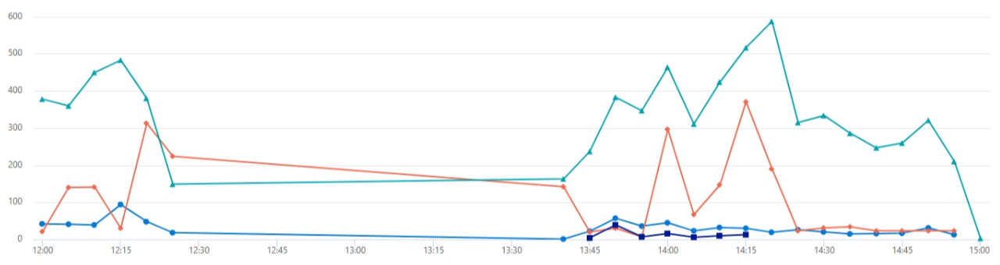

# PHP2Shell: The Hartwell Breach

**Threat hunt, Log(N) Pacific Cyber Range** · Analyst: John Samudio · Result: 18 of 18 flags

📄 **[Read the full report (PDF)](Hartwell_Breach_Threat_Hunt_Report.pdf)**

## Summary

An attacker exploited PHP2Shell (CVE-2026-109618 / CVE-2026-109619), a critical unauthenticated remote code execution flaw in PHP, on a public WordPress server belonging to the fictional Hartwell Medical Group. They planted a web shell, stole the database credentials and WordPress password hashes, tried and failed to disable the monitoring stack, and installed cron persistence for an in-memory implant. When an administrator cleaned up the web shell, the attacker re-exploited the same flaw within 57 seconds and restored persistence.

| | |
| --- | --- |
| Host | debian13 (192.168.1.120): Debian 13, WordPress 7.1.3, Apache 2.4.69, PHP 8.4.4 |
| Data | Microsoft Sentinel / Log Analytics (KQL): Apache, Apache error, Zeek-style HTTP, Sysmon for Linux, auditd, auth, syslog |
| Window hunted | 2026-10-23, 04:00 to 16:00 UTC |
| Attacker | 192.168.1.100 |

## Attack chain

1. **Recon:** Nmap scan, 1,419 requests from 192.168.1.100.
2. **Initial access:** crafted `POST` `multipart/form-data` requests abusing `session.upload_progress` (PHP2Shell).
3. **Web shell:** `health-check.php`, triggered by an `X-HMG-Debug` header with commands encoded ROT13 then Base64.
4. **Discovery:** host, network (`ss`, `ip neigh`, `ip addr`) and security-tool enumeration.
5. **Credential access:** `wp-config.php` read, `wp_users.user_pass` hashes dumped, data returned through the web shell.
6. **Defense evasion (failed):** `systemctl stop` of sysmon, auditd and SplunkForwarder as www-data, blocked by missing privileges.
7. **Persistence:** cron job running `/dev/shm/.cache-helper` every 5 minutes, reinstalled after cleanup.

## MITRE ATT&CK

| Tactic | Technique |
| --- | --- |
| Reconnaissance | T1595 Active Scanning |
| Initial Access | T1190 Exploit Public-Facing Application |
| Persistence | T1505.003 Web Shell, T1053.003 Cron |
| Defense Evasion | T1027 Obfuscated Files or Information, T1562.001 Impair Defenses (attempted) |
| Discovery | T1082, T1016, T1049, T1518.001 |
| Credential Access | T1552.001 Credentials in Files |
| Exfiltration | T1041 Exfiltration Over C2 Channel |
| Command and Control | T1105 Ingress Tool Transfer |

## Key evidence

*All log sources pause together from about 12:30 to 13:40 UTC: a collection gap, not a Sysmon failure. Sysmon and auditd keep logging after the attacker's attempt to stop them.*

## What's in this folder

| File | Contents |
| --- | --- |
| [Hartwell_Breach_Threat_Hunt_Report.pdf](Hartwell_Breach_Threat_Hunt_Report.pdf) | Full report: findings, timeline, gaps, recommendations |
| [queries/hunt-queries.kql](queries/hunt-queries.kql) | The 12 KQL queries cited in the report |
| [detections/detection-rules.kql](detections/detection-rules.kql) | 4 detection rules written from the hunt |

## Lessons learned

- **Cleanup without patching fails.** Removing the web shell did nothing while the PHP flaw stayed open.
- **Process lineage identifies the operator.** A shell whose parent is Apache, running as www-data, separates attacker activity from admin logins.
- **Least privilege contained the damage.** The attacker could not stop monitoring because www-data lacked the rights.
- **Name the gaps.** A clock offset in one log, a collection gap and a short syslog window were documented rather than guessed around.

---

*Scenario and data from the Log(N) Pacific Cyber Range. Hartwell Medical Group is fictional. Report written to the Pacific Watch reporting standard (PEAK / TaHiTI). AI assistance (Claude) was used for query drafting and report structure; all findings were verified against the logs.*
